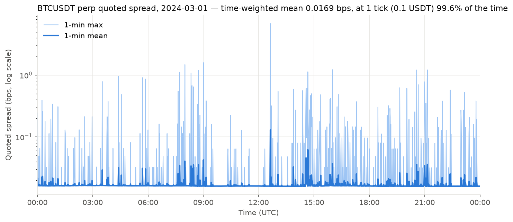
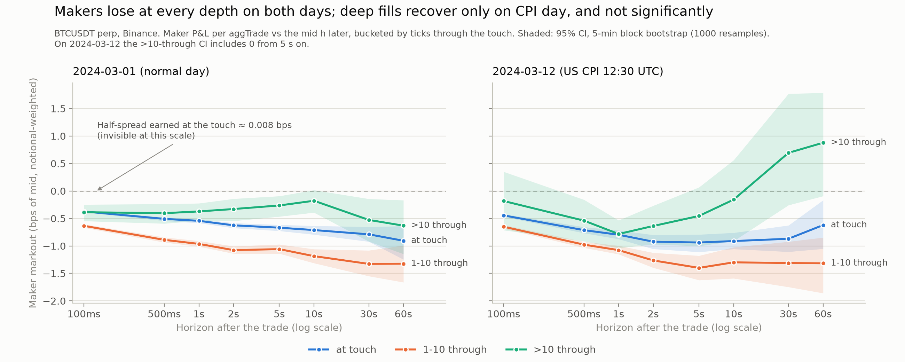

# Adverse selection at the touch of Binance USDⓈ-M perpetuals

**Summary.** On the BTCUSDT perpetual the quoted spread is one tick (0.1 USDT, ≈ 0.016 bps)
99.6 % of the time on 2024-03-01 and 98.5 % on 2024-03-12, so a maker filled at the touch
earns a half-spread of ≈ 0.008 bps. Measured against the mid 1–60 s later, the same fills
lose 0.54–0.94 bps (notional-weighted, before fees); fills one to ten ticks through the touch
lose 0.96–1.40 bps. Expressed as a quoted spread, breaking even at the touch would take
69–129 ticks for BTCUSDT and 1.7–2.3 ticks for XRPUSDT (1 s and 30 s horizons, both days),
against one tick observed. A Guéant–Lehalle–Fernandez-Tapia (GLFT) model calibrated to the
same fills gives 0.5–1.6 ticks for seven perps, close to the observed spread, but because
its mid moves independently of fills: the model has no adverse selection, and its spread is
set by the decay of the fill rate with distance from the mid.

All numbers are from two days of public data and are before fees and rebates (see
[Limitations](#5-limitations)).

---

## 1. Question

Market makers on a tick-constrained book cannot quote wider than they are forced to by the
tick, or narrower than one tick. Three spreads are compared per symbol, in ticks:

- **(a) model:** the optimal spread of an inventory-averse market maker (GLFT 2013) with a
  fill intensity λ(δ) = A e^(−κδ) estimated from the trades of the day;
- **(b) observed:** the time-weighted quoted spread;
- **(c) break-even:** the spread at which fills at the touch would have zero expected
  markout, i.e. twice the average adverse mid move after a touch fill.

If (c) ≫ (b), touch makers lose on average before fees. If (a) ≈ (b), the model reproduces
the observed spread, but that says nothing about whether it captures the cost in (c).

## 2. Data and method

### Data

| dataset | source | used for |
|---|---|---|
| `perp_bookTicker` | data.binance.vision `futures/um/daily/bookTicker` | every top-of-book change, exchange time (ms) and `update_id` |
| `perp_aggTrades` | data.binance.vision `futures/um/daily/aggTrades` | trades (ms), aggregated per taker order and price |
| `perp_fundingRate` | data.binance.vision `futures/um/monthly/fundingRate` | downloaded, not analysed yet |
| `spot_trades` | data.binance.vision `spot/daily/trades` | downloaded, not analysed yet |
| `spot_quotes` | [Tardis.dev](https://tardis.dev) free tier `binance/quotes` | downloaded, not analysed yet |

- **2024-03-01:** seven perps (BTC, XRP, ADA, DOGE, LTC, LINK, AVAX vs USDT).
- **2024-03-12:** BTCUSDT and XRPUSDT. US CPI was released at 12:30 UTC.

Perp `bookTicker` history ends on 2024-03-30. Each symbol uses its own price tick, which is
checked at load time against the gcd of the observed price gaps.

### Notation

s = +1 for a buyer-initiated trade and −1 for a seller-initiated one. p is the trade price.
m_t is the mid of the last quote strictly before the trade, with same-millisecond quotes
ordered by `update_id`. m_{t+h} is the mid of the last quote strictly before t + h.

### Metrics

- **Effective spread** ES = 2 s (p − m_t) / m_t.
- **Maker markout** at horizon h: s (p − m_{t+h}) / m_t, the passive side's P&L per unit
  notional. Realized spread is RS = 2 s (p − m_{t+h}) / m_t and price impact is
  PI = 2 s (m_{t+h} − m_t) / m_t, so ES = RS + PI. Horizons run from 100 ms to 60 s. Trades
  whose t + 60 s lies after the last quote are dropped.
- **Position vs touch:** each aggTrade is bucketed by its number of ticks through the touch,
  using the last quote before the trade: inside the touch (stale quote), at the touch,
  1 through, 2–10 through, > 10 through.
- **Taker events:** aggTrades are grouped into one aggressive order. A new event starts when
  any of the following changes: the timestamp, the side, the continuity of trade ids, or the
  price direction (a price that is not strictly worse for the taker). For each event,
  X = the number of ticks its worst fill lies beyond the touch.
- **Break-even spread** (c): S_be = 2 E_w[s (m_{t+h} − m_t)] / tick over fills at the touch,
  notional-weighted, at h = 1 s and 30 s. A maker quoting a spread S at the touch earns
  S/2 − E_w[s (m_{t+h} − m_t)] per fill, so S_be is the S at which this is zero. It equals
  the PI column restricted to touch fills.

### Fill intensity

Quotable distances on a one-tick book are δ_k = k + ½ ticks from the mid. Two readings of
"an order at level k is filled":

- *touched:* λ(δ_k) = Λ P(X ≥ k);
- *through:* λ(δ_k) = Λ P(X ≥ k + 1).

Here Λ is the event rate per side per second of one-tick exposure. If X is geometric with
P(X ≥ k) = θ^k, both readings are exponential with the same κ = −ln θ:
A_touched = Λ e^(κ/2) and A_through = Λ e^(−κ/2). The table shows the model spread for both
A, as a range.

θ is estimated by MLE censored at K, which uses only the shape on k < K:
θ̂ = S / (S + N_<K), with S = Σ min(X_i, K). Only events after a one-tick spread with
X ≥ 0 are used. The empirical P(X ≥ k) has a steep first step and a heavy tail, so κ̂
depends strongly on K (see [Robustness](#4-robustness)). The main specification is K = 1:
θ̂ = P(X ≥ 1), the probability that an event goes beyond the touch. It uses only the first
step, which decides how many fills a quote one tick wider would lose.

σ is the standard deviation of 1-minute mid log returns × mean mid, in ticks per √s.

### GLFT, exact solution

Guéant, Lehalle & Fernandez-Tapia (2013) reduce the HJB equation of the CARA market maker
with inventory bound |q| ≤ Q to the linear system v′ = M v. M is symmetric tridiagonal, with
diagonal α q² (α = κγσ²/2) and off-diagonal −η, where
η = A (1 + γ/κ)^(−(1+κ/γ)). The stationary quotes follow from the Perron eigenvector of M:

δ_b(q) = (1/γ) ln(1 + γ/κ) + (1/κ) ln(v_q / v_{q+1}),

and δ_a symmetrically. The model spread is δ_a(0) + δ_b(0), computed from the eigenvector
rather than from the paper's closed-form approximation. For BTCUSDT (σ² ≈ 4 000–10 000
ticks²/s against A ≈ 2–12 /s) the approximation is off by −20 % to +200 %, depending on γ. As γ → 0 the exact spread
tends to (2/κ)(1 + ln(1/cos(π/(2Q+2)))), not to 2/κ. This limit is one of the unit tests.

γ is set in units of tick × lot: γ = γ_USDT · L · tick / price, with lot L = 100 USDT and
Q = 1000 lots (100 k USDT). The realistic range γ_USDT ∈ [1e-6, 1e-4] /USDT is an
assumption, not an estimate: relative risk aversion 1–10 on 1e5–1e6 USDT of capital per
symbol. As a stress test, γ/κ ∈ {0.01, 0.1} is also shown.

### Inference

Confidence intervals are 95 % percentile intervals from a block bootstrap over
non-overlapping 5-minute blocks (cf. Künsch 1989). Blocks are resampled with replacement,
with 1000 resamples and a fixed seed. Each statistic is a ratio of sums (a weighted mean or θ̂), recomputed per resample.
The blocks keep the intraday dependence of order flow inside each block. Dependence across
blocks is ignored.

## 3. Results

### Quoted spread



The BTCUSDT book sits at one tick 99.6 % of the time on 2024-03-01 (98.5 % on 2024-03-12).
The other six perps sit there 96.4 % (AVAX) to ≈ 100 % (XRP) of the time. All seven are
tick-constrained, although the tick ranges from 0.016 bps (BTC) to 1.7 bps (XRP).

### Effective spread by taker size (BTCUSDT)

Notional-weighted ES per taker event, by notional quintile:

| quintile | 03-01 notional range (USDT) | 03-01 ES (bps) | 03-12 ES (bps) | 03-01 mean levels |
|---|---|---|---|---|
| Q1 | 61 – 374 | 0.044 | 0.142 | 1.06 |
| Q2 | 374 – 1 425 | 0.057 | 0.205 | 1.23 |
| Q3 | 1 425 – 4 897 | 0.077 | 0.261 | 1.34 |
| Q4 | 4 897 – 19 141 | 0.111 | 0.341 | 1.64 |
| Q5 | 19 141 – 16 M | 1.302 | 2.982 | 4.89 |

The largest 20 % of events carry 90 % of the notional (89 % on 03-12) and pay almost all of
the effective spread, because they walk the book.

### Maker markouts by depth (BTCUSDT)



Notional-weighted maker markouts per aggTrade in bps of the mid, with 95 % CIs:

| bucket | share 03-01 | 03-01, 1 s | 03-01, 30 s | 03-12, 1 s | 03-12, 30 s |
|---|---|---|---|---|---|
| inside touch | 0.7 % | 0.26 [−0.10, 0.68] | 1.10 [0.29, 1.94] | −0.16 [−0.57, 0.32] | −0.42 [−1.83, 0.98] |
| at touch | 51.4 % | −0.54 [−0.58, −0.51] | −0.79 [−0.92, −0.65] | −0.80 [−0.87, −0.72] | −0.87 [−1.11, −0.63] |
| 1 through | 3.0 % | −1.01 [−1.10, −0.92] | −1.29 [−1.83, −0.75] | −1.11 [−1.26, −0.98] | −1.25 [−1.86, −0.71] |
| 2–10 through | 10.9 % | −0.95 [−1.00, −0.90] | −1.34 [−1.55, −1.12] | −1.07 [−1.16, −0.98] | −1.33 [−1.77, −0.93] |
| > 10 through | 34.0 % | −0.37 [−0.54, −0.22] | −0.53 [−0.92, −0.14] | −0.78 [−1.04, −0.53] | 0.69 [−0.26, 1.77] |
| all | 100 % | −0.54 [−0.61, −0.48] | −0.76 [−0.93, −0.60] | −0.82 [−0.93, −0.71] | −0.26 [−0.70, 0.20] |

Makers lose at every depth on both days at 1 s. Fills 1–10 ticks through the touch lose
most. Fills more than 10 ticks through lose less on 03-01; on the CPI day their 30 s markout
turns positive, but the CI includes zero. The half-spread earned at the touch (0.008 bps)
is two orders of magnitude smaller than the loss.

XRPUSDT on 03-01 (tick 1.7 bps, half-spread 0.84 bps) shows the same pattern at the touch:
−0.55 bps at 1 s and −0.82 bps at 30 s. Here the half-spread is not negligible, but the
markout is still negative.

### Model vs observed vs break-even spread

All values in ticks. Model spread (a) uses the exact GLFT solution at q = 0 with κ from
K = 1. Where a range is shown, it runs from A_touched to A_through. (c) is notional-weighted
over touch fills, before fees.

**2024-03-01**

| symbol | tick (bps) | σ (ticks/√s) | 2/κ, K = 1 | (a) γ = 1e-4/USDT | (a) γ/κ = 0.1 | (b) mean | (c) S_be 1 s | (c) S_be 30 s |
|---|---|---|---|---|---|---|---|---|
| XRPUSDT | 1.69 | 0.74 | 0.49 [0.48, 0.50] | 0.49 | 0.57–1.53 | 1.00 | 1.66 [1.63, 1.69] | 1.98 [1.86, 2.10] |
| ADAUSDT | 1.47 | 1.21 | 0.64 [0.62, 0.65] | 0.64 | 0.83–2.02 | 1.00 | 2.14 [2.08, 2.21] | 2.07 [1.79, 2.32] |
| LTCUSDT | 1.19 | 1.48 | 0.72 [0.70, 0.73] | 0.72 | 1.02–2.36 | 1.00 | 2.87 [2.72, 3.08] | 3.21 [2.76, 3.63] |
| LINKUSDT | 0.50 | 2.35 | 1.01 [0.99, 1.02] | 1.01 | 1.75–3.35 | 1.01 | 4.54 [4.36, 4.73] | 5.33 [4.64, 6.00] |
| BTCUSDT | 0.016 | 63.5 | 1.21 [1.19, 1.23] | 1.21 | 7.41–9.41 | 1.04 | 68.8 [65.0, 73.7] | 99.3 [82.4, 116.0] |
| DOGEUSDT | 0.78 | 4.76 | 1.36 [1.31, 1.40] | 1.36 | 2.06–3.22 | 1.02 | 4.43 [4.14, 4.76] | 4.13 [3.14, 5.25] |
| AVAXUSDT | 0.24 | 7.03 | 1.62 [1.60, 1.64] | 1.62 | 4.29–6.20 | 1.06 | 10.8 [10.3, 11.4] | 11.4 [9.9, 12.8] |

**2024-03-12 (CPI day)**

| symbol | tick (bps) | σ (ticks/√s) | 2/κ, K = 1 | (a) γ = 1e-4/USDT | (a) γ/κ = 0.1 | (b) mean | (c) S_be 1 s | (c) S_be 30 s |
|---|---|---|---|---|---|---|---|---|
| XRPUSDT | 1.44 | 1.70 | 0.67 [0.64, 0.70] | 0.67 | 0.85–1.88 | 1.00 | 2.07 [1.99, 2.16] | 2.31 [2.05, 2.60] |
| BTCUSDT | 0.014 | 99.4 | 1.34 [1.31, 1.37] | 1.34–1.35 | 8.78–10.78 | 1.38 | 118 [105, 131] | 129 [95, 163] |

The observed median spread is 1 tick in every row.

Reading the table:

- **(a) vs (b).** At realistic γ the model spread is within 0.01 ticks of 2/κ, because
  inventory risk on a 100 k USDT book is negligible. 2/κ is below one tick for XRP, ADA and
  LTC, so for them the tick binds even in the model. For the other four it is 1.0–1.6
  ticks. Only the stress values of γ widen the model spread (BTC: 4.6–6.6 ticks at
  γ/κ = 0.01, 7.4–9.4 at 0.1). For BTC, γ/κ = 0.01 corresponds to γ_USDT ≈ 100 /USDT,
  six orders of magnitude above the realistic range.
- **(b) vs (c).** S_be exceeds the observed spread for every symbol, by a factor of 1.7–2.3
  for XRP and 69–129 for BTC. S_be in ticks roughly increases with σ in ticks; DOGE vs LINK
  is the one exception in the ranking. Adverse selection is a price move, and the tick is
  the unit it is counted in.
- **(a) vs (c).** The model cannot produce (c). In GLFT the mid is a Brownian motion
  independent of fills, so E[s (m_{t+h} − m_t) | fill] = 0 by construction. The agreement of
  (a) with (b) shows that the fill-rate shape and the tick are consistent with a one-tick
  spread. It does not show that one tick is profitable.

How touch makers cover the gap (rebates, fee tiers, hedging elsewhere, or cross-subsidy from
other activity) cannot be determined from this data.

## 4. Robustness

**Only the first taker event in each millisecond.** Later events in the same ms are
measured against a touch that may already be stale.

- Markouts at the touch change by at most 0.011 bps (03-01) and 0.043 bps (03-12).
- 1–10 through changes by at most 0.14 bps.
- > 10 through changes by up to −0.55 bps (03-12, 30 s), in the direction of larger losses.
- Notional-weighted ES per quintile falls by 0.01–0.04 bps (03-01) and 0.07–0.23 bps
  (03-12).
- 2/κ (K = 1) changes by at most 0.03 ticks for all seven perps and both days.

**Off-grid trades.** 127 (03-01) and 56 (03-12) BTCUSDT aggTrades are off the 0.1 grid.
Dropping them changes the markouts by less than 0.001 bps and the Q5 ES by −0.03 bps.

**Break-even without sweeps.** S_be using only touch fills from taker events that hit a
single level:

| symbol | day | single-level share of touch notional | S_be 1 s, all | S_be 1 s, single level | S_be 30 s, all | S_be 30 s, single level |
|---|---|---|---|---|---|---|
| XRPUSDT | 03-01 | 93 % | 1.66 | 1.63 [1.59, 1.66] | 1.98 | 1.98 [1.86, 2.10] |
| ADAUSDT | 03-01 | 91 % | 2.14 | 2.11 [2.04, 2.19] | 2.07 | 2.05 [1.75, 2.34] |
| LTCUSDT | 03-01 | 90 % | 2.87 | 2.80 [2.63, 3.03] | 3.21 | 3.12 [2.64, 3.57] |
| LINKUSDT | 03-01 | 87 % | 4.54 | 4.52 [4.33, 4.73] | 5.33 | 5.51 [4.74, 6.32] |
| BTCUSDT | 03-01 | 83 % | 68.8 | 58.9 [54.6, 64.6] | 99.3 | 90.1 [70.5, 109.9] |
| DOGEUSDT | 03-01 | 84 % | 4.43 | 4.26 [3.93, 4.63] | 4.13 | 4.01 [2.84, 5.30] |
| AVAXUSDT | 03-01 | 76 % | 10.8 | 10.5 [9.9, 11.3] | 11.4 | 11.3 [9.6, 13.0] |
| XRPUSDT | 03-12 | 92 % | 2.07 | 1.98 [1.90, 2.08] | 2.31 | 2.32 [2.05, 2.61] |
| BTCUSDT | 03-12 | 84 % | 118 | 111 [96, 124] | 129 | 130 [93, 166] |

Excluding sweeps lowers S_be by at most 14 % (BTC, 1 s); S_be still exceeds the observed
spread everywhere. Two caveats apply:

- The filter conditions on the size of the taker event.
- A single-level event can still consume the whole touch level.

**Inventory bound Q** (exact spread at q = 0, lot 100 USDT, A = A_touched, in ticks):

| | Q = 1 | Q = 5 | Q = 10 | Q = 20 | Q = 1000 |
|---|---|---|---|---|---|
| BTC 03-01, γ → 0 limit | 1.6295 | 1.2520 | 1.2225 | 1.2135 | 1.2101 |
| BTC 03-01, γ = 1e-4/USDT | 1.6295 | 1.2521 | 1.2226 | 1.2140 | 1.2125 |
| BTC 03-01, γ/κ = 0.1 | 7.4136 | 7.4136 | 7.4136 | 7.4136 | 7.4136 |
| XRP 03-01, γ = 1e-4/USDT | 0.6591 | 0.5064 | 0.4945 | 0.4908 | 0.4896 |
| BTC 03-12, γ = 1e-4/USDT | 1.8093 | 1.3903 | 1.3577 | 1.3483 | 1.3469 |
| XRP 03-12, γ = 1e-4/USDT | 0.9083 | 0.6979 | 0.6814 | 0.6764 | 0.6749 |

At realistic γ the dependence on Q is a pure boundary effect: avoiding the bound widens the
quotes even of a risk-neutral maker, and the γ → 0 limit (2/κ)(1 + ln(1/cos(π/(2Q+2))))
matches the numerical values. The effect is +3.5 % at Q = 5 and below 0.3 % from Q = 20 on.
Under stress γ the stationary inventory distribution is so narrow that the bound never
binds, and Q has no effect.

**Lot size L**, with Q · L = 100 k USDT fixed and γ = 1e-4/USDT:

| | L = 50 (Q = 2000) | L = 100 (Q = 1000) | L = 1000 (Q = 100) | L = 10 000 (Q = 10) | 2/κ |
|---|---|---|---|---|---|
| BTC 03-01 | 1.2118 | 1.2125 | 1.2178 | 1.2356 | 1.2101 |
| XRP 03-01 | 0.4896 | 0.4896 | 0.4900 | 0.4947 | 0.4895 |
| BTC 03-12 | 1.3460 | 1.3469 | 1.3540 | 1.3771 | 1.3437 |
| XRP 03-12 | 0.6748 | 0.6749 | 0.6758 | 0.6822 | 0.6745 |

Across a factor of 200 in L, the model spread stays within 2.5 % of 2/κ. L = 100 USDT is
below the median taker event of every perp on 2024-03-01 (197 USDT for XRP to 2.6 k USDT
for BTC), so a typical fill is at least one lot. L is a modelling unit, not an estimate.

**Censoring K.** 2/κ in ticks (95 % CI):

| symbol | day | K = 1 | K = 5 | K = ∞ |
|---|---|---|---|---|
| XRPUSDT | 03-01 | 0.49 [0.48, 0.50] | 0.52 [0.50, 0.54] | 0.52 [0.50, 0.55] |
| ADAUSDT | 03-01 | 0.64 [0.62, 0.65] | 0.69 [0.68, 0.72] | 0.70 [0.68, 0.72] |
| LTCUSDT | 03-01 | 0.72 [0.70, 0.73] | 0.80 [0.78, 0.82] | 0.81 [0.79, 0.83] |
| LINKUSDT | 03-01 | 1.01 [0.99, 1.02] | 1.19 [1.16, 1.21] | 1.23 [1.20, 1.26] |
| BTCUSDT | 03-01 | 1.21 [1.19, 1.23] | 2.78 [2.72, 2.85] | 9.03 [8.13, 10.08] |
| DOGEUSDT | 03-01 | 1.36 [1.31, 1.40] | 1.64 [1.58, 1.70] | 1.78 [1.70, 1.85] |
| AVAXUSDT | 03-01 | 1.62 [1.60, 1.64] | 2.23 [2.18, 2.27] | 2.60 [2.53, 2.68] |
| XRPUSDT | 03-12 | 0.67 [0.64, 0.70] | 0.77 [0.72, 0.81] | 0.84 [0.75, 0.92] |
| BTCUSDT | 03-12 | 1.34 [1.31, 1.37] | 3.19 [3.08, 3.29] | 14.6 [12.4, 16.8] |

For the large-tick perps the geometric model fits, and K hardly matters. For BTC it does
not fit: the tail of X is far heavier than the first step, and 2/κ ranges from 1.2 to
9–15 ticks depending on K. Even the K = ∞ value stays far below S_be (69–129 ticks), so
the conclusion of section 3 does not depend on K.

## 5. Limitations

- **Two days.** One ordinary day and one CPI day; the full cross-section only on
  2024-03-01. The CIs reflect intraday sampling noise, not day-to-day variation.
- **No fees or rebates.** Markouts, break-even and model spreads are all before fees.
  Binance's current pages list 0.02 % maker / 0.05 % taker for the base USDⓈ-M tier, but I
  found no source dated March 2024. The fee tier of the makers in the data (VIP level,
  rebates, liquidity-provider programs) is unknown. At the BTCUSDT touch the half-spread is
  ≈ 0.008 bps, far below any plausible non-rebated maker fee, so quoting at the touch is
  only profitable with rebates or a high tier.
- **No queue position.** The data shows which levels traded, not where a given order sat
  in the queue. "Touched" and "through" bound the fill rate of a new order. The markouts
  average over all realized fills, and therefore include whatever selection makers already
  achieve by cancelling.
- **bookTicker has no depth.** Only best bid/ask and their sizes are observed, so X is
  inferred from trade prices, and depth beyond the touch is not seen directly.
- **κ mixes order flow and book shape.** X depends both on how large takers are and on how
  much liquidity rests at each level. The estimated λ(δ) is a reduced form, not the
  structural fill rate a new quote would face.
- **Millisecond timestamps.** Quotes and trades are stamped in ms. Quotes within a ms are
  ordered by `update_id` and trades by trade id, but the order of a trade relative to a
  quote in the same ms is not known. The "first event per ms" check bounds this effect.
- **Merged taker orders.** Two orders in the same ms whose prices continue in the same
  direction cannot be separated and count as one event.
- **Model.** GLFT assumes Brownian mid, Poisson fills, exponential intensity and CARA
  utility. The γ range is an assumption, not an estimate.
- **Not covered.** Spot, the spot–perp basis and funding are downloaded but not analysed.

## 6. Reproduction

```bash
python -m venv .venv && source .venv/bin/activate
pip install -e ".[dev]"
pytest -q

# 1. Data (Parquet under data/, gitignored). BTCUSDT: all datasets for both days.
python -m crypto_microstructure.download --date 2024-03-01
python -m crypto_microstructure.download --date 2024-03-12
# Other perps: bookTicker and aggTrades only.
python - <<'EOF'
from datetime import date
from crypto_microstructure.download import fetch
days = {date(2024, 3, 1): ["XRPUSDT", "ADAUSDT", "DOGEUSDT", "LTCUSDT", "LINKUSDT", "AVAXUSDT"],
        date(2024, 3, 12): ["XRPUSDT"]}
for day, symbols in days.items():
    for symbol in symbols:
        for key in ["perp_bookTicker", "perp_aggTrades"]:
            print(fetch(key, symbol, day))
EOF

# 2. Quoted spread plots
python examples/plot_perp_spread.py --date 2024-03-01
python examples/plot_perp_spread.py --date 2024-03-12

# 3. ES by size, markouts by depth, robustness (writes data/results/markouts_*.parquet)
python examples/perp_taker_events.py --date 2024-03-01
python examples/perp_taker_events.py --date 2024-03-12
python examples/perp_taker_events.py --date 2024-03-01 --symbol XRPUSDT
python examples/plot_markouts.py

# 4. Fill intensity (kappa for K = 1, 5, inf; sigma; A), then the three-spread table
python examples/fill_intensity.py --date 2024-03-01
python examples/fill_intensity.py --date 2024-03-12 --symbols BTCUSDT XRPUSDT
python examples/glft_table.py --date 2024-03-01
python examples/glft_table.py --date 2024-03-12 --symbols BTCUSDT XRPUSDT

# 5. Q and lot-size sensitivity
python examples/glft_sensitivity.py --date 2024-03-01
python examples/glft_sensitivity.py --date 2024-03-12
```

Step 4 must run after step 1, and `glft_table.py` and `glft_sensitivity.py` read the output
of `fill_intensity.py`. A full BTCUSDT day has ≈ 39 M quotes, and each script takes a few
minutes per day. `examples/spread_in_ticks.py` and `examples/perp_metrics_window.py` are
earlier exploratory scripts.

### Data quirks

- **Off-grid perp quotes.** On 2024-03-01, 274 of 39 M BTCUSDT bookTicker rows have a price
  off the 0.1 grid, for example an ask of 61431.87 for 0.001 BTC. They are kept in Parquet
  and dropped at load time; off-grid trades are flagged.
- **Spot quotes come from Tardis.** data.binance.vision has no spot bookTicker. The Tardis
  free tier provides 100 ms snapshots rebuilt from `depth@100ms`, on the 1st of each month
  only.
- **Optional live recorder.** `python -m crypto_microstructure.record --hours 48` records
  the websocket `bookTicker` streams for spot and perp into `data/live/`. The analysis does
  not use it.

## References

- Avellaneda, M. & Stoikov, S. (2008). High-frequency trading in a limit order book.
  *Quantitative Finance* 8(3), 217–224.
- Guéant, O., Lehalle, C.-A. & Fernandez-Tapia, J. (2013). Dealing with the inventory risk:
  a solution to the market making problem. *Mathematics and Financial Economics* 7(4),
  477–507. [arXiv:1105.3115](https://arxiv.org/abs/1105.3115)
- Künsch, H. R. (1989). The jackknife and the bootstrap for general stationary
  observations. *Annals of Statistics* 17(3), 1217–1241.
